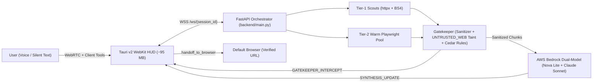

# DICE — Zero-Extension Floating WebKit HUD & AWS Multi-Agent Voice Platform

**Voice-steered, cloud-offloaded web research with deterministic Cedar-style security gating — keeping local client RAM under ~100 MB.**

---

## Problem & Solution

Deep web research today causes **tab sprawl** (multi-GB browser RAM bloat), **blind trust in single-source summaries**, and **prompt-injection risk** when autonomous agents touch live web forms.

**DICE** replaces multi-tab browsing with two decoupled planes:

1. **Zero-Extension Floating WebKit HUD (`hud/`):** A native **Tauri v2** always-on-top overlay summoned over any browser with `Alt+Space` (`Option+Space` on macOS). It never injects into Chrome/Safari profiles and uses **ElevenLabs WebRTC Conversational AI** (plus full-parity Silent Mode text input) to steer cloud agents mid-sentence.
2. **AWS Cloud Swarm & Gatekeeper (`backend/`):** A **FastAPI + WebSocket** orchestrator that runs parallel **httpx/BeautifulSoup** (Tier 1) and **pre-warmed Playwright Chromium** (Tier 2) scouts in the cloud, resolves cross-source contradictions with **AWS Bedrock dual-model synthesis**, and freezes untrusted mutating actions behind a **Cedar-style Gatekeeper Approval Card**.

---

## Key Capabilities

- **Floating WebKit HUD (~95 MB RAM):** Summoned via `Alt+Space` / `Option+Space`; tracks live RSS memory (`get_hud_memory_mb`) alongside `tabs_offloaded` to AWS, and hands off only the single verified winning URL to the user's default browser.
- **Full-Duplex Voice Steering & Mid-Flight Barge-In:** Wired with `@elevenlabs/client` (`webrtc`) and 4 Client Tools (`dispatch_swarm`, `steer_swarm`, `spotlight_evidence`, `handoff_to_browser`). Interrupting mid-flight immediately cancels stale cloud scouts (`status: "CANCELLED"`) and re-routes synthesis.
- **Showing Stage & Citation Mind Map:** Displays sanitized `evidence_cards` (immune to `X-Frame-Options` iframe blocks), comparison cards, voice-synced quote highlighting with Contradiction Badges, `"Pin Note"` context persistence, a custom SVG node-edge Mind Map, and a 1-click **Narrated / High-Contrast** accessibility toggle.
- **Taint Tracking & Cedar-Style Gatekeeper:** Strips `<script>`, `<style>`, `noscript`, and hidden DOM elements (`display:none`, `opacity:0`, `font-size:0`), tags all web payloads as `UNTRUSTED_WEB`, and freezes `FORM_SUBMIT`, `CHECKOUT_CLICK`, or `EXTERNAL_POST` behind a blocking red `GATEKEEPER_INTERCEPT` card until signed via `APPROVAL_DECISION`.

---

## Architecture



---

## Tech Stack

| Layer | Technologies |
|---|---|
| **Client HUD (`hud/`)** | Tauri v2 (Rust + OS WebKit), React 18, TypeScript, Tailwind CSS v4, Vite 6, `@elevenlabs/client` |
| **Cloud Orchestrator (`backend/`)** | Python 3.11+, FastAPI, Uvicorn, Pydantic v2, `httpx`, `beautifulsoup4`, Playwright (warm pool) |
| **AI & Security** | AWS Bedrock Converse API (Router + Reasoning models), ElevenLabs Conversational AI (WebRTC), Cedar-style taint policy gate |

---

## Repository Structure

```text
DICE/
├── SOURCE_OF_TRUTH.md      # Locked architecture & WebSocket wire contracts
├── PROMPT_PERSON_A.md      # Person A spec (Floating WebKit HUD)
├── PROMPT_PERSON_B.md      # Person B spec (AWS Backend & Gatekeeper)
├── hud/                    # Tauri v2 + React + ElevenLabs WebRTC HUD
│   ├── src-tauri/          # Rust shell, Alt+Space shortcut, opener, sysinfo RAM metric
│   └── src/                # types.ts, wsClient.ts (+ VITE_MOCK_WS), components/
└── backend/                # FastAPI + Playwright + Bedrock + Cedar Gatekeeper
    ├── main.py             # GET /health, WS /ws/{session_id}
    ├── swarm.py            # Tier-1 httpx + Tier-2 warm Playwright pool + SSRF guards
    ├── gatekeeper.py       # HTML sanitizer, UNTRUSTED_WEB tainting, Cedar evaluator
    ├── synthesis.py        # Dual-model Bedrock Converse + prompt-injection quarantine
    ├── schemas.py          # Pydantic v2 wire schemas
    └── test_ws.py          # 23 offline end-to-end verification tests
```

---

## Quick Start

### 1. Backend (`backend/`)

```bash
cd backend
python -m venv .venv
# Windows: .venv\Scripts\activate   |   macOS/Linux: source .venv/bin/activate
pip install -r requirements.txt
python -m playwright install chromium

# Offline verification (no AWS credentials required)
python test_ws.py
```

Create `backend/.env` from `backend/.env.example` (set `MOCK_BEDROCK=true` & `MOCK_FETCH=true` for offline mode, or configure AWS Bedrock credentials via `aws configure` / `aws login`), then start the server:

```bash
uvicorn main:app --port 8000
curl -s http://localhost:8000/health
```

### 2. Floating WebKit HUD (`hud/`)

```bash
cd hud
npm install
cp .env.example .env
```

In `hud/.env`, set:
- `VITE_WS_URL=ws://localhost:8000/ws/demo1`
- `VITE_MOCK_WS=false` (or `true` for standalone UI demo without backend)
- `VITE_ELEVENLABS_AGENT_ID=<your_agent_id>`

Run the native floating HUD (requires Rust toolchain) or browser preview:

```bash
npm run tauri dev   # Native always-on-top WebKit HUD
# or: npm run dev   # Browser preview at http://localhost:1420
```

---

## 2-Minute Judge Demo Flow

1. **Summon HUD:** Press `Alt+Space` (`Option+Space`) over Chrome/Edge to bring up the floating HUD (~95 MB RAM in the Glass-Box Monitor).
2. **Dispatch Swarm:** Speak or click **Demo Query** → **Dispatch** (`Compare top 3 ANC headphones under 25k INR and check Reddit hinge issues`). Watch live `TELEMETRY` events and `Tabs Offloaded to AWS` increment while `SYNTHESIS_UPDATE` populates the Showing Stage and SVG Mind Map.
3. **Mid-Flight Barge-In:** Switch to **Steer / Barge-In** (or interrupt by voice) with `"Drop Sony XM5"` → observe immediate `CANCELLED` scout telemetry and refined comparison cards.
4. **Spotlight & Handoff:** Click a **Contradiction** card or **Mind Map** node to spotlight the exact quote in the Showing Stage, pin a note, and click **Open Verified Link in Browser** to hand off cleanly.
5. **Gatekeeper Intercept:** Observe the blocking red **Gatekeeper Approval Card** (`FORBID_UNTIL_SIGNED` / `forbid_untrusted_mutating_action`) freeze a tainted `FORM_SUBMIT` until **Approve** or **Reject** is clicked.

---

## Verification Status

- `backend/test_ws.py`: **23/23 PASS** (offline contract, sanitization, tainting, barge-in cancellation, and Gatekeeper freeze/release checks).
- `backend` `/health`: Verified `status: "ok"` with warm Playwright pool (`size: 2`, `available: true`).
- `hud`: Verified `npx tsc --noEmit`, `npm run build`, native `cargo build` (`dice-hud.exe`), and end-to-end UI flow in mock mode.
